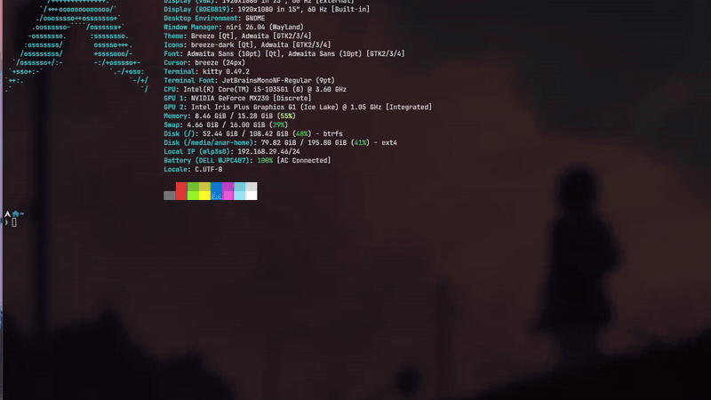

<div align="center">

# niri-sidestage

**A slide-out window and workspace switcher for [niri](https://github.com/YaLTeR/niri).**<br>
Touch the edge of a monitor, pick a window, get on with your day.

[](https://github.com/anisharaz/niri-sidestage/actions/workflows/ci.yml)
[](https://github.com/anisharaz/niri-sidestage/releases)
[](LICENSE)



</div>

- **Always one touch away.** Move the pointer to the screen edge and a strip of your windows slides out. Click one to jump to it.
- **Per monitor.** Every monitor gets its own strip with only its own windows and workspaces.
- **Out of the way.** It reserves no screen space and never resizes your windows.
- **Keyboard friendly.** Bind one key to open it, then use the arrows and Enter.

## Quick start

You need niri **26.04** and the GTK 4 libraries. On Arch:

```sh
sudo pacman -S gtk4 gtk4-layer-shell
```

**1. Install.** This downloads the latest release, checks its SHA-256 checksums and puts the binary
in `~/.local/bin`. It also drops a documented default config at
`~/.config/niri-sidestage/config.toml` if you do not have one yet (it never overwrites yours):

```sh
curl -fsSL https://github.com/anisharaz/niri-sidestage/releases/latest/download/install.sh | sh
```

On Arch you can use a package instead, see [Other ways to install](#other-ways-to-install).

**2. Try it now.**

```sh
niri-sidestage &
```

Move the pointer to the left edge of a monitor, level with where the blue marker sits.

**3. Start it with niri.** Add this to `~/.config/niri/config.kdl`. Use the full path
(`/home/you/.local/bin/niri-sidestage`) if `~/.local/bin` is not on niri's `PATH`:

```kdl
spawn-at-startup "niri-sidestage"
```

**4. Optional: a key to open it.** Add inside your `binds { }` block:

```kdl
Mod+Tab { spawn "niri-sidestage" "toggle"; }
```

That is all. Everything below is reference.

## Using it

| Do this | To get this |
|---|---|
| Touch the screen edge, level with the strip | The strip slides out. It closes shortly after the pointer leaves. |
| Click a window | Focus it. niri scrolls it into view. |
| **Workspaces** / **Windows** button | Switch between the window list and the workspace view (each workspace with its windows as icons). Set `view = "workspaces"` to open in the workspace view. |
| Click a workspace heading | Switch to that workspace. |
| Drag an icon onto another workspace | Move the window there. |
| Middle-click a window | Close it. |
| Hover a window | See its full title. |
| `niri-sidestage toggle` | Open the strip on the focused monitor and give it the keyboard: arrows or Tab to move, Enter to pick, Escape to dismiss. |

A monitor with only one window in total shows no strip. The list follows niri's layout (column,
then row, floating windows last); focusing a window never reorders it, only moving one does.

### Commands

```
niri-sidestage                 run the strip
niri-sidestage --pinned        run the strip and keep it open
niri-sidestage toggle          open the strip on the focused monitor, or dismiss it
niri-sidestage open | close    the same, one direction only
niri-sidestage toggle --output eDP-1    target a specific monitor
niri-sidestage --version
```

A strip opened with `toggle` or `open` stays open and holds the keyboard until you pick something,
press Escape, or toggle it again. Only one copy runs at a time; starting a second prints a message
and exits.

## Configuration

Optional. The settings live in `~/.config/niri-sidestage/config.toml` (or under
`$XDG_CONFIG_HOME`): a flat list of `key = value` lines, where `#` starts a comment. Restart
niri-sidestage after editing it. Settings are layered, each key overriding the one before:

1. the built-in defaults
2. a system-wide file, `/etc/xdg/niri-sidestage/config.toml` (or under `$XDG_CONFIG_DIRS`), which
   the Arch packages install
3. your own file in `~/.config`, where you only need the keys you want to change
4. the `NIRI_SIDESTAGE_GAP` environment variable

The shipped default file, [`config/config.toml`](config/config.toml), contains exactly the
built-in defaults:

```toml
view = "windows"       # "windows" or "workspaces": which view the strip opens in
side = "left"          # "left" or "right"
gap = "auto"           # px width of the edge trigger; "auto" reads `gaps` from your niri config
panel_width = 152      # 100 to 600
hide_delay_ms = 250    # how long after the pointer leaves before the strip slides away
slide_ms = 170         # slide animation time
min_trigger = 200      # the trigger zone is as tall as the strip, but at least this tall
```

The edge trigger lives in niri's outer gap, so it never covers a window. With `gap = "auto"` it
follows the `gaps` value in your niri config (including `include`d files) and falls back to 5.

Environment variables:

| Variable | Meaning |
|---|---|
| `NIRI_SIDESTAGE_GAP` | Edge trigger width in pixels. Overrides the config file and auto-detection. |
| `NIRI_SIDESTAGE_DEBUG` | Print pointer enter/leave/motion events to stderr. |
| `NIRI_SIDESTAGE_START_WS` | Start in the workspace breakdown view. |

## Other ways to install

**Pin a version or change the location.** The install script reads `NIRI_SIDESTAGE_VERSION`
(for example `v0.3.0`) and `PREFIX` (default `~/.local`). Run `sh install.sh uninstall` to remove
the binary (your config stays). To read the script first, it is [`install.sh`](install.sh) in this repo. The prebuilt binary is
x86_64 Linux and needs glibc 2.34 or newer.

**Arch Linux.** Two `PKGBUILD`s are in [`packaging/aur/`](packaging/aur). They are not published
on the AUR yet, so build them from this repo. Both install the binary, the default config in
`/etc/xdg/niri-sidestage/` (pacman keeps your edits on upgrade) and the license, and they conflict
with each other.

```sh
# prebuilt: installs the binary, config and license straight from the GitHub release
cd packaging/aur/niri-sidestage-bin && makepkg -si

# or build from source
cd packaging/aur/niri-sidestage && makepkg -si
```

**From source.** Needs a Rust toolchain (edition 2024) and the libraries from the quick start:

```sh
git clone git@github.com:anisharaz/niri-sidestage.git
cd niri-sidestage
cargo build --release
install -Dm755 target/release/niri-sidestage ~/.local/bin/niri-sidestage
```

## How it works

One process, no daemon.

- It follows niri's event stream (`niri-ipc`) and keeps a snapshot of workspaces and windows per
  output. Clicks send `FocusWindow`, `FocusWorkspace`, `CloseWindow` or `MoveWindowToWorkspace`
  actions back over the IPC socket.
- Per monitor there is one full-height layer-shell window anchored to the chosen edge. An input
  region keeps only the trigger zone interactive while closed, and the zone plus the visible strip
  while open. Because it is a single surface, the pointer never hands off between windows, which
  avoids flicker from enter/leave races.
- The window has a fixed size. Opening and closing slides the content inside it, driven by the
  frame clock. Resizing a layer-shell window on every frame lags behind the compositor and tears.
- `toggle`, `open` and `close` talk to the running strip over a Unix socket at
  `$XDG_RUNTIME_DIR/niri-sidestage.sock`. While opened that way the strip takes exclusive keyboard
  focus, and releases it when dismissed.

It started as an attempt to copy macOS Stage Manager. That version hid windows on parked
workspaces, which fought with niri's layout (widths, focus, workspace switching), so it was dropped.
Windows now stay exactly where niri put them and the strip is purely a switcher.

## Limitations

- The open strip covers roughly the 160px of the window beneath it at the screen edge. It reserves
  no space on purpose, so it cannot avoid that.
- No window thumbnails, only app icons and titles.
- You can only drop a window onto a workspace that is shown in the breakdown, so not onto an empty
  one.
- Tested on niri 26.04 on Arch Linux with two 1080p monitors at scale 1. Other setups, such as
  fractional scaling, are untested, and so is the bottom edge of the trigger zone with
  `side = "right"`.
- niri's default top-left hot corner opens the overview. If you reach the edge by sliding up along
  it, you may brush that corner. You can disable it with `hot-corners { off }` in your niri config.

## License

[MIT](LICENSE)
